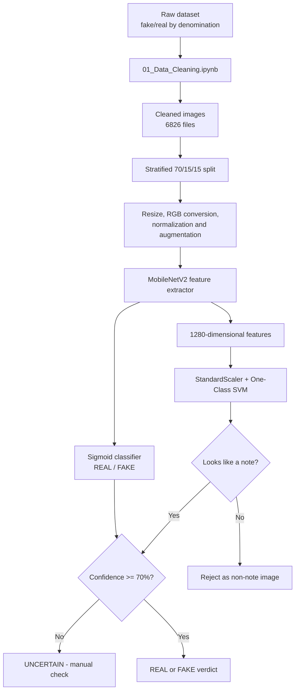

# Currency-Safe

[](https://jupyter.org/)
[](https://www.tensorflow.org/)
[](https://scikit-learn.org/)
[](https://www.python.org/)

Currency-Safe is a notebook-based machine-learning project for checking whether an image of an Indian currency note appears **real or fake**. Before classification, the workflow verifies that the input resembles a currency-note photograph and rejects out-of-domain images. Predictions that do not meet the configured confidence threshold are reported as uncertain for manual review.

The repository contains the complete data-cleaning notebook, model-training and evaluation notebook, and the trained model artifacts needed to reuse the pipeline without retraining.

## Problem Statement

Currency images can contain duplicate files, unsupported formats, withdrawn denominations, class imbalance, and images that are not currency notes at all. A useful detector therefore needs more than a binary classifier: it must clean and validate the dataset, avoid split leakage, handle the imbalanced classes, evaluate errors, and provide a safe response when the input is unfamiliar or the model is unsure.

## Project Objectives

- Prepare a reliable image dataset for real/fake note classification.
- Remove withdrawn Rs 2000 notes, unreadable files, duplicate images, and unsupported AVIF files.
- Preserve the distribution of both labels and denominations during dataset splitting.
- Train a transfer-learning image classifier for `fake` and `real` notes.
- Add an out-of-domain check for images that do not look like currency notes.
- Return a confidence-aware result instead of forcing an uncertain prediction.
- Save reusable model, scaler, and One-Class SVM artifacts.

## Key Features

- **Dataset cleaning:** removes Rs 2000 folders, checks image readability, detects duplicate files with MD5 fingerprints, and converts AVIF images to JPEG.
- **Leakage-aware splitting:** creates repeatable, stratified 70/15/15 train, validation, and test splits across label/denomination groups.
- **Image preprocessing:** converts images to RGB, resizes them to `224 × 224`, and normalizes pixel values to `[0, 1]`.
- **Augmentation:** applies horizontal flips, small rotations, zoom, and contrast changes to training batches.
- **Transfer learning:** uses ImageNet-pretrained MobileNetV2 with global average pooling, dropout, and a sigmoid output.
- **Class imbalance handling:** computes training-set class weights.
- **Two-stage training:** trains the classifier head first, then fine-tunes the final 54 of 154 MobileNetV2 layers at a lower learning rate.
- **Evaluation:** reports accuracy, confusion matrix, precision, recall, F1-score, denomination-level results, and wrong predictions.
- **Confidence handling:** marks predictions below 70% confidence as uncertain.
- **Input validation:** uses a StandardScaler and RBF One-Class SVM over MobileNetV2 features to reject images that do not resemble note photographs.
- **Reusable artifacts:** includes the trained Keras model and serialized scikit-learn preprocessing/checking objects.

## Technologies Used

| Technology | Use in the project |
| --- | --- |
| Python | Notebook implementation |
| Jupyter Notebook | Interactive cleaning, training, evaluation, and inference |
| TensorFlow / Keras | Image pipeline, MobileNetV2 transfer learning, training, and model serialization |
| NumPy | Numerical arrays and feature processing |
| pandas | Image metadata tables and grouped evaluation |
| scikit-learn | Stratified splitting, class weights, metrics, `StandardScaler`, and `OneClassSVM` |
| Pillow | Image validation, format inspection, and conversion |
| Matplotlib | Learning curves and misclassification visualizations |
| joblib | Serialization of the scaler and One-Class SVM |

Installable dependencies are listed in [`requirements.txt`](requirements.txt).

## System Architecture



The inference path in `02_CurrencySafe_Model.ipynb` first prepares the image, checks it with the feature-based One-Class SVM, then applies the real/fake classifier and confidence rule.

## Dataset and Results

The notebooks document the following cleaned dataset:

| Split or property | Value |
| --- | ---: |
| Cleaned images | 6,826 |
| Fake images | 2,289 |
| Real images | 4,537 |
| Training set | 4,778 |
| Validation set | 1,024 |
| Test set | 1,024 |
| Image size | `224 × 224 × 3` |
| Test accuracy | 99.22% |
| Test errors | 8 of 1,024 |
| Fake notes classified as real | 4 |
| Real notes classified as fake | 4 |
| Validation note-image acceptance by One-Class SVM | 93.2% |

These figures are the recorded outputs in the notebooks and depend on the documented dataset and split.

## Repository Structure

```text
Currency-Safe/
├── 01_Data_Cleaning.ipynb       # Dataset cleaning and preprocessing checks
├── 02_CurrencySafe_Model.ipynb  # Training, evaluation, inference, and artifact creation
├── currencysafe_model_v2.keras   # Saved MobileNetV2-based classifier
├── currencysafe_scaler.joblib    # Saved feature StandardScaler
├── currencysafe_svm.joblib       # Saved One-Class SVM input validator
├── requirements.txt              # Python dependencies
├── .gitignore                    # Dataset, archive, cache, and local-file exclusions
└── README.md                     # Project documentation
```

The original image dataset is intentionally not stored in this repository; `data/` is excluded by `.gitignore`.

## Installation and Setup

### 1. Clone the repository

```bash
git clone https://github.com/Nithinks944/Currency-Safe.git
cd Currency-Safe
```

### 2. Create and activate a virtual environment

```bash
python -m venv venv
```

On macOS/Linux:

```bash
source venv/bin/activate
```

On Windows PowerShell:

```powershell
venv\Scripts\Activate.ps1
```

### 3. Install dependencies

```bash
python -m pip install --upgrade pip
pip install -r requirements.txt
```

### 4. Prepare the dataset

The notebooks expect a dataset directory containing:

```text
<dataset-path>/
└── data/
    └── data/
        ├── fake/
        │   ├── 10/
        │   ├── 20/
        │   ├── 50/
        │   ├── 100/
        │   ├── 200/
        │   └── 500/
        └── real/
            ├── 10/
            ├── 20/
            ├── 50/
            ├── 100/
            ├── 200/
            └── 500/
```

Update the `dataset_path` variable in each notebook to point to a **copy** of the dataset. The cleaning notebook deletes withdrawn-note folders and duplicate files from the copy it processes.

## How to Run

Start Jupyter:

```bash
jupyter notebook
```

Run the notebooks in this order:

1. Open `01_Data_Cleaning.ipynb` and update `dataset_path`. Run all cells to validate and clean the copied dataset.
2. Open `02_CurrencySafe_Model.ipynb`, update `dataset_path`, and run the data checks, split, preprocessing, training, and evaluation cells.
3. Use the saved artifacts in the repository to load the trained model, scaler, and One-Class SVM without retraining.
4. Set `my_photo` to the path of an image and run `check_note_full(my_photo)` for the full input-validation and classification flow.

The notebooks are the executable interface for this project; no web server, command-line application, or package entrypoint is included.

## Working Methodology

1. **Clean:** remove withdrawn Rs 2000 notes, find unreadable images, identify duplicate byte content, verify that duplicates do not cross labels, and convert AVIF images to JPEG.
2. **Organize:** build a metadata table containing image path, label, and denomination.
3. **Split:** create repeatable stratified train, validation, and test sets using the combined label/denomination group.
4. **Prepare:** resize and normalize images; augment training batches only.
5. **Train:** use class-weighted binary cross-entropy with MobileNetV2 transfer learning and early stopping.
6. **Fine-tune:** unfreeze the last 54 MobileNetV2 layers and continue with a smaller learning rate.
7. **Evaluate:** calculate predictions at a `0.5` real-probability threshold and inspect classification errors.
8. **Validate inputs:** fit a StandardScaler and RBF One-Class SVM to the classifier's 1,280-dimensional training features.
9. **Decide safely:** reject non-note images, flag confidence below 70%, or return a `REAL`/`FAKE` verdict with confidence.

## Screenshots

No standalone screenshots or image assets are currently included in the repository. The notebooks generate learning-curve plots, wrong-prediction grids, and input previews interactively when their visualization cells are run.

## Future Enhancements

The current repository does not include a separate production application. Practical next steps would be to:

- Add a user-facing interface or API around `check_note_full`.
- Add automated tests for preprocessing and inference behavior.
- Add a reproducible configuration mechanism for dataset paths and thresholds.
- Track experiments and model versions outside the notebooks.
- Add representative, license-cleared screenshots and sample inputs.
- Add a project license and document the source dataset license.

## License

No `LICENSE` file is currently included in this repository. Add an appropriate license before distributing or reusing the project.
